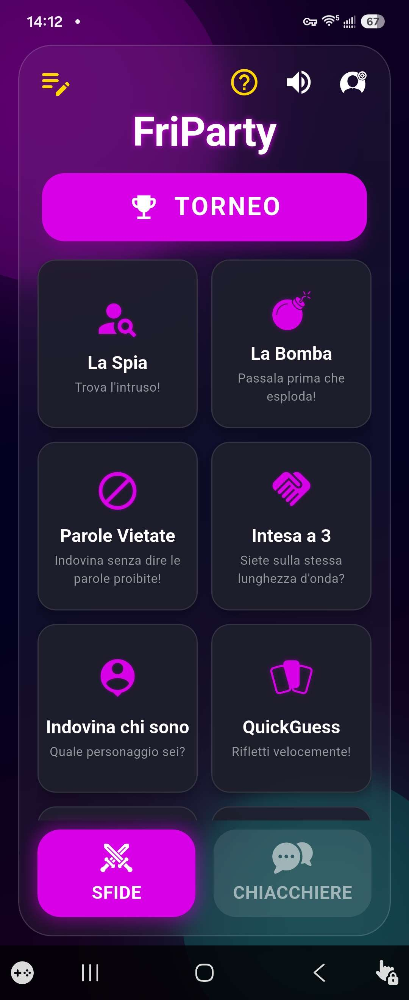
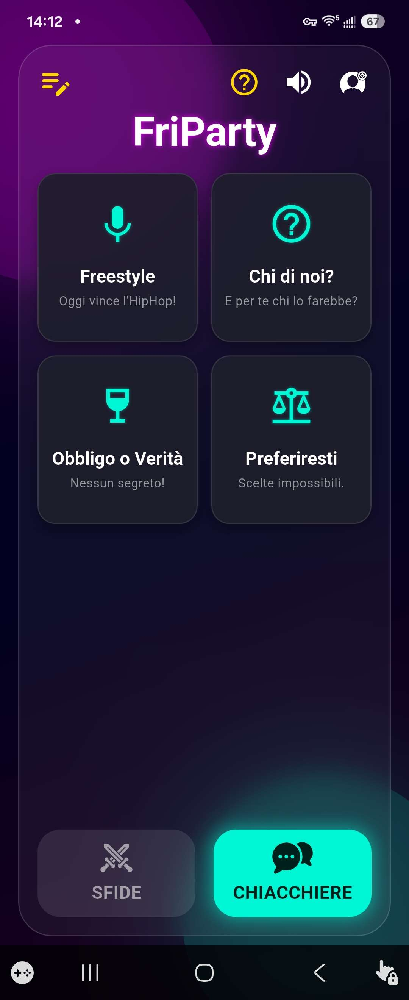
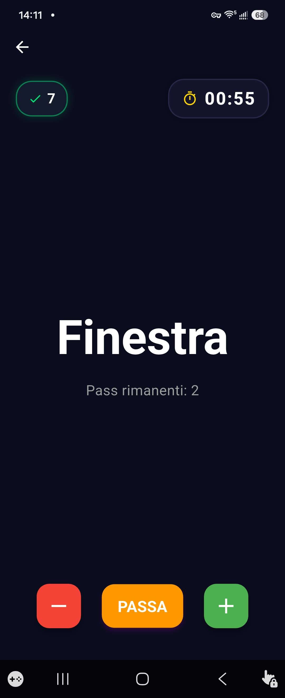
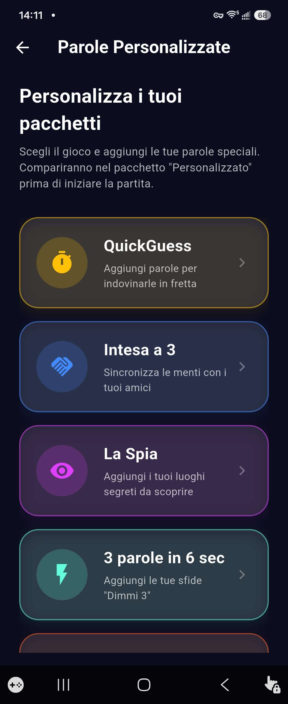
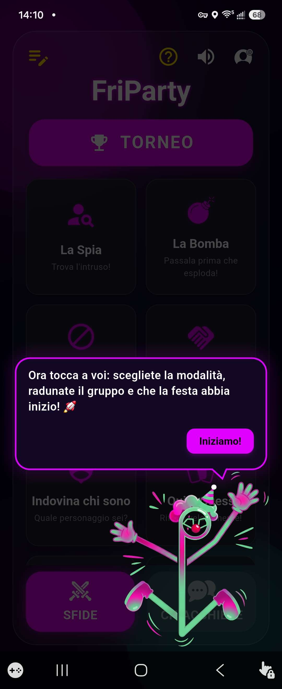

# 🎲 FriParty

  <strong>Il Party Game definitivo per serate tra amici, giocabile tutti insieme con un solo smartphone.</strong>

  
  
  
  
  

---

## 📱 Download

L'applicazione è disponibile ufficialmente su dispositivi Android:

👉 **[Scarica FriParty su Google Play Store](INSERISCI_QUI_IL_LINK_PLAY_STORE)**

---

## 📖 Panoramica del Progetto

**FriParty** è un'applicazione mobile sviluppata in **Flutter** che racchiude una vasta collezione di minigiochi interattivi pensati per animare feste, ritrovi e serate di gruppo. 

Il punto di forza dell'app è la sua **immediatezza conviviale**: non serve che tutti i partecipanti scarichino l'app o entrino in lobby virtuali. Basta passare un unico dispositivo tra i giocatori per sfidarsi a tempo, testare la rapidità mentale, conoscersi a fondo o improvvisare rime.

---

## 📸 Galleria Screenshot

  
  
  

  
  

---

## ✨ Funzionalità Chiave

- **Un Solo Dispositivo:** Progettato interamente per il pass-and-play offline attorno a un tavolo o sul divano.
- **🏆 Modalità Torneo Adattiva:** Il sistema seleziona dinamicamente i minigiochi più adatti in base al numero esatto di giocatori presenti (da 2 a 15 partecipanti), gestendo sfide individuali, round a squadre e un tabellone con podio finale.
- **✏️ Pacchetti & Parole Personalizzate:** Possibilità di creare e salvare liste di parole, termini segreti o sfide personalizzate per minigiochi come *QuickGuess*, *Intesa a 3*, *La Spia* e *3 parole in 6 sec*, ideali per serate a tema o battute interne tra amici.
- **🌍 Supporto Multilingua (i18n):** Interfaccia e database delle parole completamente disponibili sia in **Italiano** che in **Inglese**.
- **100% Offline-First:** Nessuna connessione a internet richiesta per giocare; ideale anche in viaggio o in luoghi privi di segnale.

---

## 🎮 Modalità e Minigiochi

### 💬 Chiacchiere & Social
*Rompighiaccio perfetti per creare atmosfera, svelare aneddoti e divertirsi insieme.*

| Gioco | Descrizione |
| :--- | :--- |
| **Freestyle** | Improvvisazione in rima su basi Hip-Hop con cambi di turno a tempo. |
| **Chi di noi?** | Domande provocatorie per scoprire chi nel gruppo farebbe una determinata follia. |
| **Obbligo o Verità** | Il classico evergreen rivisitato con domande pungenti e penitenze. |
| **Preferiresti** | Dilemmi impossibili e bizzarri su cui discutere animatamente. |

### ⚡ Sfide & Competizione
*Minigiochi adrenalinici su tempo, bluff, riflessi e rapidità di pensiero.*

| Gioco | Descrizione |
| :--- | :--- |
| **La Spia** | Trova l'infiltrato che non conosce il luogo segreto prima che scada il tempo. |
| **La Bomba** | Dici la parola appartenente alla categoria e passa il telefono prima dell'esplosione! |
| **Parole Vietate** | Fai indovinare la parola alla squadra evitando le parole tabù proibite. |
| **Intesa a 3** | Componi una frase una parola a testa con il compagno per guidare l'intuito del terzo. |
| **Indovina chi sono** | Scopri il personaggio misterioso facendo domande a cui rispondere solo con sì o no. |
| **QuickGuess** | Quiz e round rapidi per mettere alla prova la velocità di associazione mentale. |
| **3 parole in 6 sec** | Di getto: cita 3 elementi validi per la categoria richiesta in appena 6 secondi. |
| **Alza la Posta** | Asta di abilità: scommetti su quante risposte riesci a dare prima di sbagliare. |
| **Termometro** | Trova il valore esatto sulla scala graduata per centrare il bersaglio. |
| **Assassino** | Elimina i compagni con un occhiolino senza farti cogliere in flagrante dal detective. |

---

## 🛠️ Stack Tecnologico

- **Framework:** Flutter (Dart SDK)
- **Architettura UI:** State management locale modulare con widget reattivi e animazioni fluide
- **Audio Engine:** Gestione integrata per basi audio in loop (BPM sync) ed effetti sonori realtime
- **Persistenza Dati:** Salvataggio locale su storage per pacchetti di parole personalizzate e preferenze
- **Localizzazione:** Sistema i18n dinamico (Italiano / Inglese)

> **Nota:** Questo repository funge da vetrina pubblica del progetto, changelog e spazio per suggerimenti e segnalazioni bug. Il codice sorgente dell'app è proprietario e mantenuto in una repository privata.

---

## 📜 Crediti & Licenze Audio

- **Beats Freestyle:** Jake Plah (*Jakeiparla*) — Pixabay
- **Musica di Sottofondo (BGM):** *"Private Eye"* & *"Protofunk"* by Kevin MacLeod (incompetech.com)  
  *Licensed under Creative Commons: By Attribution 4.0 License*

---

## 📬 Segnalazioni & Feedback

Hai un suggerimento per un nuovo minigioco o hai riscontrato un problema?
- Apri una [GitHub Issue](https://github.com/TUO_USERNAME/friparty/issues)
- Visita il mio portfolio: [simonecatenaccio.com](https://simonecatenaccio.com)
